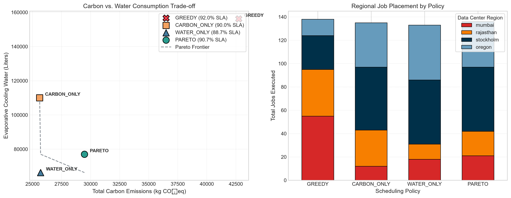

# EcoCluster: Geo-Distributed Carbon- and Water-Aware Cluster Scheduler

[](https://www.python.org/downloads/)
[](https://fastapi.tiangolo.com)
[](https://opensource.org/licenses/Apache-2.0)

EcoCluster is a discrete-event trace simulator and multi-objective scheduler designed for geo-distributed data centers. It tackles the **Carbon-Water Ecological Conflict**: shifting computing workloads to regions rich in midday solar energy often incurs severe evaporative cooling water loss in arid, high-temperature climates.

By modeling ambient wet-bulb temperatures ($T_{wb}$), dynamic $PUE$, non-linear $WUE_{\text{site}}$, and regional Water Stress Indexes ($WSI$), EcoCluster co-optimizes operational carbon emissions, freshwater evaporation, electricity costs, and SLA deadlines.

---

## Key Features

- **Environmental Digital Twin**: Evaluates dynamic hourly dry-bulb, relative humidity, wet-bulb psychrometrics (Stull's equation), power usage effectiveness ($PUE$), and on-site water usage effectiveness ($WUE_{\text{site}}$).
- **Regions Modeled**:
  - **Mumbai, India**: Coal-dominant baseload, moderate cooling demand.
  - **Rajasthan, India**: High midday solar surplus, extreme ambient heat and drought vulnerability ($WSI = 5.0$).
  - **Stockholm, Sweden**: Low-carbon hydro/nuclear grid with free ambient dry cooling.
  - **Oregon, USA**: Pacific Northwest hydro-rich grid with seasonal cooling variations.
- **Pareto-Optimal Engine**: Filters non-dominated execution candidates across $CO_2$, water, cost, and latency dimensions.
- **Trace Ingestion Pipeline**: Ingests and normalizes cluster workloads (e.g., Alibaba PAI / Google cluster traces) into compressed Parquet datasets.
- **Production-Ready API**: FastAPI backend for querying real-time environmental telemetry, evaluating individual tasks, and triggering batch trace simulations.

---

## System Architecture

```text
+-----------------------------------------------------------------------------------+
|                                 Trace Ingestion                                   |
|   (Alibaba PAI / Google Trace Normalization into Parquet: Arrival, Runtime, SLA)  |
+-----------------------------------------+-----------------------------------------+
                                          |
                                          v
+-----------------------------------------------------------------------------------+
|                            Physical Digital Twin                                  |
|   - Reanalysis Telemetry: Open-Meteo dry-bulb (Ta) & relative humidity (RH)       |
|   - Psychrometric Modeling: Stull wet-bulb formula (Twb)                          |
|   - Thermodynamic Curves: Dynamic PUE(Twb) & Non-linear WUEsite                   |
|   - Grid Signals: Diurnal solar/wind carbon intensity (CI) & drought weight (WSI) |
+-----------------------------------------+-----------------------------------------+
                                          |
                                          v
+-----------------------------------------------------------------------------------+
|                        Multi-Objective Pareto Engine                              |
|   - Feasibility Filter: t_start + d_j <= D_j                                      |
|   - Non-Dominated Sorting: Pareto frontier extraction across (CO2, Water, Cost)   |
|   - Scalarized Decision Scoring: Water Stress-Weighted Objective Minimization     |
+-----------------------------------------+-----------------------------------------+
                                          |
                                          v
+-----------------------------------------------------------------------------------+
|                        Capacity-Constrained Simulator                             |
|   - Temporal Resource Grid: Dynamic load reservation (kW <= Cap_r)                |
|   - Discrete-Event Clock & SLA Enforcement                                        |
|   - Telemetry Output: FastAPI Interface & Columnar Metric Log                     |
+-----------------------------------------------------------------------------------+
```

---

## Core Formulas

### 1. Ambient Wet-Bulb Psychrometrics (Stull's Equation)
$$T_{wb} = T_a \cdot \arctan\left(0.151977 \sqrt{RH + 8.313659}\right) + \arctan(T_a + RH) - \arctan(RH - 1.676331) + 0.00391838 \cdot (RH)^{1.5} \cdot \arctan(0.023101 \cdot RH) - 4.686035$$

### 2. Cooling Thermodynamics ($PUE$ and $WUE_{\text{site}}$)
$$PUE(T_{wb}) = \begin{cases} 
1.10, & T_{wb} \le 15^{\circ}\text{C} \\
1.10 + 0.012 \cdot (T_{wb} - 15.0), & T_{wb} > 15^{\circ}\text{C}
\end{cases}$$

$$WUE_{\text{site}}(T_{wb}) = \begin{cases} 
0.05 \text{ L/kWh}, & T_{wb} \le 15^{\circ}\text{C} \\
0.05 + 0.015 \cdot (T_{wb} - 15.0)^2 \text{ L/kWh}, & T_{wb} > 15^{\circ}\text{C}
\end{cases}$$

### 3. Pareto Selection Scoring
$$\min_{(r, t) \in \mathcal{P}_j} \left[ w_{\text{carbon}} \cdot C_{j,r,t} + \Big(w_{\text{water}} \cdot WSI_r \cdot W_{j,r,t}\Big) + w_{\text{cost}} \cdot \$_{j,r,t} + w_{\text{wait}} \cdot (t - a_j) \right]$$

---

## Benchmark Results (150 Trace Jobs, 500 kW/Region Cap)

| Policy | SLA Met (%) | Total $CO_2$ (kg) | Total Water (L) | Total Cost ($) | $\Delta CO_2$ vs. Greedy | $\Delta$ Water vs. Greedy |
| :--- | :---: | :---: | :---: | :---: | :---: | :---: |
| **Greedy (Run-Now)** | 92.0% | 42,744.89 | 156,184.30 | 9,657.09 | Baseline | Baseline |
| **Carbon-Only** | 90.0% | 25,617.49 | 110,066.26 | 7,374.45 | **-40.1%** | -29.5% |
| **Water-Only** | 88.7% | 25,699.36 | 66,321.48 | 7,286.26 | -39.9% | **-57.5%** |
| **Pareto Eco (Ours)** | **90.7%** | **29,470.87** | **77,017.72** | **7,705.12** | **-31.1%** | **-50.7%** |



---

## Quickstart

### 1. Environment Setup
```powershell
git clone https://github.com/praneetjena-prog/EcoCluster.git
cd EcoCluster
python -m venv venv
.\venv\Scripts\Activate.ps1
pip install -r requirements.txt
```

### 2. Ingest Workload Traces & Weather Telemetry
```powershell
# Fetch reanalysis hourly weather (Open-Meteo) and carbon profiles
python scripts/fetch_weather_carbon.py

# Ingest and normalize cluster traces (Alibaba PAI / Google) to Parquet & CSV
python scripts/ingest_traces.py
```

### 3. Run Benchmark Simulation
Run trace simulations comparing Greedy, Carbon-Only, Water-Only, and Pareto Eco policies under a 500 kW regional concurrency cap:
```powershell
python scripts/run_benchmark.py
```

### 4. Plot Pareto Trade-off Curves
Generate publication-quality trade-off visualizations and regional job allocation plots:
```powershell
python scripts/plot_pareto_curves.py
```
Outputs are saved directly to `reports/figures/pareto_benchmark_comparison.png`.

### 5. Launch FastAPI Observability API
Start the FastAPI service:
```powershell
uvicorn src.api:app --reload
```
Access the interactive OpenAPI Swagger documentation at: `http://localhost:8000/docs`

Key endpoints:
- `GET /telemetry/environment`: Query hourly weather, wet-bulb temp ($T_{wb}$), dynamic $PUE$, $WUE_{\text{site}}$, and carbon intensity.
- `POST /schedule/single`: Schedule an individual batch or AI training job with chosen policy.
- `POST /simulate/batch`: Run trace simulations across policies with regional capacity constraints.

### 6. Run Test Suite
```powershell
python -m pytest
```

---

## Project Structure

```text
eco-cluster-scheduler/
├── data/
│   ├── carbon/             # Regional grid carbon intensity profiles
│   ├── traces/             # Ingested cluster trace workloads (Parquet/CSV)
│   └── weather/            # Hourly wet-bulb and dry-bulb weather data
├── reports/
│   └── figures/            # Pareto trade-off and allocation charts
├── scripts/
│   ├── fetch_weather_carbon.py  # Weather and carbon telemetry ingestion
│   ├── ingest_traces.py         # Alibaba PAI / Google trace normalization
│   ├── plot_pareto_curves.py    # Pareto frontier & distribution visualization
│   └── run_benchmark.py         # Comparative 4-policy trace simulator
├── src/
│   ├── schedulers/
│   │   ├── baseline.py     # Greedy, Carbon-Only, and Water-Only schedulers
│   │   └── pareto.py       # Multi-objective Pareto scheduler
│   ├── api.py              # FastAPI observability & execution service
│   ├── env_twin.py         # Physical digital twin (Stull Twb, PUE, WUEsite)
│   ├── schemas.py          # Pydantic data contracts
│   └── simulator.py        # Discrete-event capacity-constrained simulator
└── tests/
    └── test_scheduler.py   # Unit & regression test suite
```

---

## License

This project is licensed under the Apache License 2.0 - see the [LICENSE](LICENSE) file for details.
